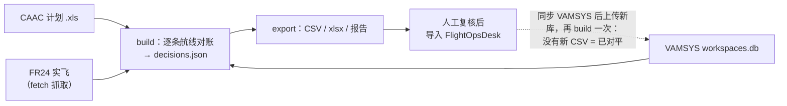
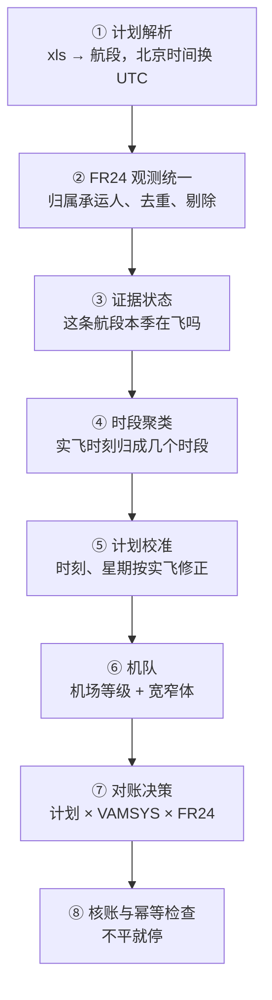
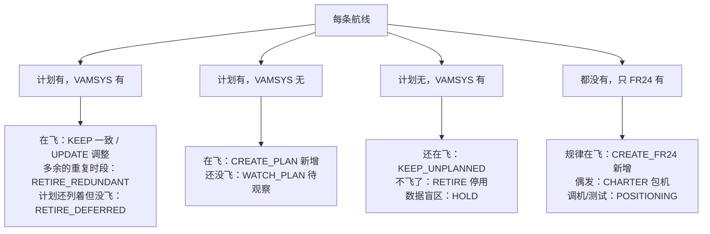

# vCCA 航季航班计划工具 —— 使用说明

把 **CAAC 预先计划** + **FR24 实飞数据** 与 **VAMSYS 现行航线**（FlightOpsDesk 的 `workspaces.db`，只读）对账，输出
FlightOpsDesk 导入 CSV、核查 xlsx 和 HTML 报告。设计与判定规则见 [docs/重构计划.md](docs/重构计划.md)。

本工具只面向 **Linux 网页服务器**（Ubuntu/Debian，systemd + gunicorn 1 worker × 8 threads + nginx HTTPS）。
部署步骤见 [deploy/DEPLOY.md](deploy/DEPLOY.md)。日常使用都在网页里完成（第 8 节）；命令行主要给运维和开发用。

## 1. 功能与判定逻辑

### 1.1 它做什么

每个航季，把三份数据逐条航线对账，算出 VAMSYS 应该**新增、调整、停用**哪些航线，生成 FlightOpsDesk 可直接导入的 CSV，
外加一份能逐条核对的报告。工具从不直接改 VAMSYS / FlightOpsDesk：CSV 由人工确认后导入。

适用于**任何航季**（冬春、夏秋都一样）：航季起止日期取自 `season.toml`，不写时从计划文件 FD23/FD24 的众数推算
（年份取航季文件夹名开头的四位数字，结束日期早于开始日期时自动跨年）；下文的"本季"指航季开始日之后。换季只需新建航季文件夹、
上传新计划，不改代码（第 7 节）。

| 输入 | 含义 | 来源 |
|---|---|---|
| CAAC 预先计划（`.xls`） | 打算飞什么：班号、航段、时刻、星期、机型 | 民航局航季计划，每季上传 |
| FR24 实飞 | 实际飞了什么 | `fetch` 从 Flightradar24 增量抓取，存 `cache/fr24_cache.db` |
| VAMSYS 现行航线 | 航线库里现在有什么（基线，只读） | FlightOpsDesk 的 `workspaces.db`，网页上传 |

原则：**计划为基准，FR24 为证据，VAMSYS 为现状**。计划说要飞、FR24 证实在飞，才新增；计划和实飞有出入时按实飞校准；
证据不足的只标记，不动现有航线。



### 1.2 三个步骤

1. **`fetch` 抓取**：目标 = 计划班号 ∪ VAMSYS 航线班号 ∪ 机队注册号（新出现的自动加入，30 天没见到就移出）。
   每个目标有新鲜度等级，只抓"到期"的，所以日常只有几十到几百个请求：

   | 等级 | 哪些目标 | 多久重抓 |
   |---|---|---|
   | P0 | 没抓过 / 上次失败 | 马上 |
   | P1 | 上次 build 认为"不确定"的（没在飞、换承运人、近期实飞少、计划与实飞冲突、在新增/停用清单上…） | 24 小时 |
   | P2 | 其余稳定的 | 7 天 |

   全局限速（默认 2 次/秒），遇 429 自动降速退避，连续失败 8 次自动停；结果按 FR24 航班 id 累积进缓存，中断后可续抓。
   全机队注册号深扫默认每 7 天一次（`--deep` 手动触发）。
2. **`build` 计算**：对账（见 1.3–1.5），每条航线一个"决定"，写入 `decisions.json`；同时把每个目标的确定程度回写缓存，
   决定下次 `fetch` 抓谁。
3. **`export` 导出**：只读 `decisions.json` 生成 CSV、`重算清单.xlsx`、`report.html`、`summary.json`，可对同一次计算重复导出。

### 1.3 build 内部流程



| 步骤 | 做什么 |
|---|---|
| ① 计划解析 | 只取四家目标航司（CCA / CAO / CCD / BJN）；呼号转班号（`CCA1234` → `CA1234`）；每行最多两段，北京时间减 8 小时得 UTC，跨日时星期顺移；只排一天的计划行（FD23 = FD24）单独标记；检测"去回程缺境外段"。 |
| ② 观测统一 | 以**呼号**为主键（CAO 很多记录只有呼号）；判断每条记录属于哪家承运人；剔除他司呼号、取消/备降、起降同场；按 FR24 航班 id 去重；机场代码换成 VAMSYS 口径（`[airports] alias`）。时间分三段：季前、本季（航季开始后）、近期（最新数据前 21 天）。 |
| ③ 证据状态 | 每个（承运人, 呼号, 起, 降）按顺序判一个状态：在飞 `active` / 只有排班 / 换了承运人 / 呼号改飞别的航段 / 季前飞过本季停了 / 365 天没飞过 / 没抓到数据。 |
| ④ 时段聚类 | 把实飞时刻（排班时刻优先）聚成若干"时段"，近期和实飞的样本权重更高；季中改过时刻的，旧时段作废。 |
| ⑤ 计划校准 | 见 1.4。 |
| ⑥ 机队 | 见 1.6。 |
| ⑦ 对账决策 | 见 1.5。 |
| ⑧ 安全检查 | 见 1.7。 |

### 1.4 时刻和星期怎么定

计划为基准，FR24 有足够证据时才改：

- **时刻**：某时段实飞 ≥ 2 次、且与计划差 > 15 分钟 → 用 FR24 时刻；整小时偏差（夏令时）近期 ≥ 2 次即可采用。
- **加星期**：计划没有的星期，FR24 在 ≥ 2 个不同周都飞了 → 增补（`WEEKDAY_ADDED`）。
- **删星期**：计划有、但本季观测 ≥ 4 周该星期一次没飞，且同航线其他计划星期的执飞率 ≥ 75% → 删除并标记**人工复核**（`WEEKDAY_DROPPED`）。
- **拆班合并**：计划把同一班拆成几行、实际是同一个时段的，合并成一行，星期取并集。
- **漏列时段**：FR24 有一个离计划所有时段都很远（> 45/60 分钟）、实飞 ≥ 2 次的时段 → 补成新时段。
- **只排一天的计划行**：同航段有全季行就忽略；没有、但本季实飞 ≥ 5 次 → 当作在飞航线，星期按实飞。

### 1.5 决策分类

按"这条航线在计划 / VAMSYS 里有没有"分四种情况，再看 FR24 证据：



| 决策 | 什么时候 | 去向 |
|---|---|---|
| `KEEP` | 两边都有，时刻、星期、机队都对得上 | 不导出 |
| `UPDATE` | 两边都有，但时刻 / 星期 / 机队有出入（只写变化的字段；Cost Index 沿用现值） | `03_routes_update` |
| `RETIRE_REDUNDANT` | VAMSYS 同航线有多余的 ID，配不上任何实飞时段 | `02_routes_retire` |
| `RETIRE_DEFERRED` | 计划还列着，但本季没飞（暂缓停用，确认后再导） | `02b_routes_retire_deferred` |
| `CREATE_PLAN` / `CREATE_EXTRA_SLOT` | 计划有、VAMSYS 没有，FR24 在飞 / FR24 多出一个时段 | `04_routes_create` |
| `WATCH_PLAN` | 计划有、VAMSYS 没有，FR24 还没飞（等真飞了再建） | 只在报告 |
| `KEEP_UNPLANNED` | 计划没有、VAMSYS 有，FR24 还在飞（按实飞校准，有出入则转 `UPDATE`） | 不导出 / `03` |
| `RETIRE` | 计划没有、VAMSYS 有，换承运人 / 换航段 / 季前就停 / 365 天没飞 / 旧排班消失 | `02_routes_retire` |
| `HOLD` | 去回程缺失段、FR24 也看不到（数据盲区，不动） | 只在报告 |
| `CREATE_FR24` | 计划和 VAMSYS 都没有，FR24 实飞 ≥ 3 次且跨 ≥ 2 周 | `04_routes_create` |
| `CHARTER` | 只出现一两天、或星期不规律的临时加班 / 包机 | 只在报告 |
| `POSITIONING` | 呼号不规范、无班号短途、起降同场（调机 / 测试） | 只在报告 |
| `AIRPORT_ADD` | 要建的航线用到 VAMSYS 没有的机场（相关新建航线标注"先导入机场"） | `01_airports_add` |

VAMSYS 里已经设了 End Date 的航线视为"停用中"，不重复停用；如果计划又需要它，就 `UPDATE` 清空 End Date 并复核。

### 1.6 机队怎么选

1. CAO / CCD / BJN：固定机队（`rules/fleets.toml`）。
2. CCA 先定**宽体还是窄体**：看计划机型和 FR24 实际机型。偶尔的换机不算数：某机型至少飞 2 次、且占比 ≥ 10%（`fr24_ac_min_share`）才计入。
   都没有信息时参考 VAMSYS 现值，再没有就按窄体并标记复核。
3. 按两端机场里**较低的飞行区等级**（`rules/airport_grades.toml`）选机型池：3C 只有 AJ27；4C 窄体 10 型；两端都允许 757 再加 B752；
   宽体 4D 只有 B762/B763，4E 13 型，4F 再加 B748；宽体航线遇到 4D 以下机场降为窄体并标记。
4. 再去掉机场排除的机型（高原机场、机位尺寸）。排除后为空就回退窄体池并标记复核。未定级的机场按 4C 处理并标记复核。

### 1.7 安全检查

- **去向核账**：VAMSYS 每条商业航线必须有且只有一个决定，总数对不上 `build` 就报错，不会导出半截结果。
- **幂等**：把本次决定套用到 VAMSYS 后再算一次，应当没有任何变化。所以导入 CSV、上传新库后再跑，只会剩下真正的新变化。
- **CSV 自检**：导出前检查列名、ID、时刻格式、星期拼写、机队 ID 是否存在，有问题就不写 CSV。
- **人工复核**：删星期、未定级机场、机队回退等不确定的判断都标 `needs_review`，集中在 xlsx 的"9 人工复核"表和单独的 `_待复核` CSV。
- **阈值可调**：上面所有数字都在 `settings.toml` 的 `[thresholds]` 里（网页"配置 → 生效值"可查），报告里统计每条阈值影响了多少航线。

## 2. 目录布局

代码和数据分开，数据目录由唯一的环境变量 **`VCCA_HOME`** 指定（服务器上 `/srv/vcca`，systemd 设置）：

```
/opt/vcca/app        代码（本仓库）            /opt/vcca/venv   Python ≥ 3.11 虚拟环境
$VCCA_HOME/          （= /srv/vcca）
  settings.toml                    全站设置（只写与默认值不同的键）
  seasons/<航季>/                  season.toml（可选，本季设置与覆盖）+ CAAC .xls + output/<运行>/
  vamsys/workspaces.db             VAMSYS 数据（网页上传，自动精简；备份 workspaces.<时间>.db 保留 5 份）
  rules/airport_grades.toml        机场飞行区等级、高原/机位排除
  rules/fleets.toml                机队分组与机型映射
  cache/fr24_cache.db              FR24 缓存（SQLite，按航班 id 累积；可随时中断续抓）
  state/                           网页账号 users.toml、会话、任务日志 jobs/、临时文件 tmp/、FR24 会话 fr24_session.json
/etc/vcca/vcca.env                 FR24_USER / FR24_PASSWORD（只这两项；工具只检查是否存在，不打印）
```

- `VCCA_HOME` 不存在时所有命令都会报"数据目录不存在"。没有其他路径设置。
- 航季文件夹：`seasons/` 下含 `season.toml` **或** 标准 CAAC `（三字码）.xls` 的文件夹。
- `FlightRadarAPI/` 是借用的第三方库（MIT），不要修改。

## 3. 配置

合并顺序（逐键）：**代码默认值**（`vcca/config.py` 的 `DEFAULTS` / `Thresholds`）→ **`settings.toml`**（全站）→ **`season.toml`**（本航季）。

| 文件 | 内容 |
|---|---|
| `settings.toml` | `[vamsys] workspace_id / collection`、`[operators]`、`[airports]`、`[export]`、`[fetch]`、`[thresholds]` |
| `seasons/<航季>/season.toml` | `[season]`：`name`、`start_date` / `end_date`（可省略，取计划 FD23/FD24 众数）、`plan_files`、`plan_groups`、`plan_tz_offset_min`；也可写上面任一节的同名键，只对本航季覆盖 |

- 不再是配置项（旧文件里有会警告并忽略）：`[vamsys] db_path`（固定 `$VCCA_HOME/vamsys/workspaces.db`）、`[fetch] cache_dir`（固定 `$VCCA_HOME/cache`）。
- 网页"配置"页可编辑 `settings.toml`、`season.toml` 和两个规则文件（先校验再保存、自动备份、可恢复历史版本），"生效值"页列出每个键的最终值和来源（默认 / 全站 / 航季），与默认不同的高亮。
- 旧的一体式 `season.toml` 迁移：

```powershell
python vcca_plan.py migrate-config --from 旧路径/season.toml            # 预览
python vcca_plan.py migrate-config --from 旧路径/season.toml --write    # 写入 $VCCA_HOME/settings.toml 和 seasons/<名>/season.toml
```

  等于默认值的键会省略（`--name` 指定航季文件夹名，`--force` 覆盖已有文件）。

## 4. 命令行

在代码目录下（服务器：`sudo -u vcca env VCCA_HOME=/srv/vcca /opt/vcca/venv/bin/python /opt/vcca/app/vcca_plan.py …`）：

```powershell
python vcca_plan.py            # 文字菜单
python vcca_plan.py status     # 配置、计划文件、VAMSYS、账号、缓存新鲜度
python vcca_plan.py fetch      # 增量抓取 FR24（按 P0/P1/P2 有效期）
python vcca_plan.py build      # 计算 → seasons/<航季>/output/<时间>/decisions.json
python vcca_plan.py export     # 生成 xlsx / CSV / report.html / summary.json
python vcca_plan.py run        # fetch + build + export
python vcca_plan.py test       # 规则与格式测试（样本数据 tests/fixtures/home；--full：再用 $VCCA_HOME 真实数据只读验收）
python vcca_plan.py web-user set 名字 | list | delete 名字    # 网页账号
python vcca_plan.py serve      # 开发用网页服务器，只监听 127.0.0.1（默认端口 8770，--port 改）
```

常用参数：
- `--season 2026-27-1`：指定航季（默认取 `$VCCA_HOME/seasons` 下最新的航季）
- `fetch --dry-run`：只列出将抓的目标、请求数和预计耗时，不发请求
- `fetch --deep`：全机队注册号扫描（约 550 个请求；默认每 7 天自动做一次）
- `fetch --flights CA1234,CA5678` / `--regs B-2091`：只抓指定班号 / 注册号
- `fetch --boards ZBAA,ZSPD` / `--search`：可选的机场看板 / 搜索索引（默认不抓）
- `export --run 2026-11-26_0613`：对某次计算重新导出（文件夹名是计算时的 UTC 时间）

## 5. 日常流程

1. `run`（或依次 `fetch` → `build` → `export`）。日常增量抓取通常几十到几百个请求。
2. 在网页"结果"页（或 `output/<时间>/report.html`）浏览：概览、各分类表格、单条航线"计划 / VAMSYS / FR24"对照、与上次运行的差异。
   星期变更在表格里显示为 新增<ins>绿</ins> / 删除<del>红</del>；详情里的"FR24 逐日记录"是 周 × 星期 的日历格：
   绿 = 推荐时段实飞，黄 = 其他时段实飞，红 = 有计划未见实飞，虚线 = 尚未到期的计划，底行是各星期在推荐时段的实飞周数。
   一条航线有多个排期（如 CAO1008）时，详情先列"同航线全部排期" S1…Sn（点行切换），日历里每班后标 Sn 表示归入哪个排期，
   蓝 = 其他排期实飞，黄 = 不属于任何排期。
3. 看 `重算清单.xlsx` 的 **9 人工复核** 表，处理 `_待复核` CSV 里的条目（确认无误的行可合并进对应主 CSV）。
4. 按顺序在 FlightOpsDesk 导入：
   1. `01_airports_add_*.csv`（如有）
   2. `02_routes_retire_*.csv`（停用，写 End Date）
   3. `02b_routes_retire_deferred_*.csv`（暂缓停用，确认后再导）
   4. `03_routes_update_*.csv`
   5. `04_routes_create_*.csv`
5. FlightOpsDesk 同步 VAMSYS 后，在网页"数据"页上传新的 `workspaces.db`，再跑一次 `build`：结果应只剩新的变化。

`CHARTER`（临时加班/包机）、`POSITIONING`（调机/测试）、`WATCH_PLAN`（计划有但近期未飞）、`HOLD` 只出现在报告里，不进 CSV。

## 6. 输出文件（`seasons/<航季>/output/<YYYY-MM-DD_HHMM>/`）

| 文件 | 内容 |
|---|---|
| `重算清单.xlsx` | 0 总览 / 1 新增 / 2 调整 / 3 停用 / 4 计划外临时航班 / 5 待观察 / 6 一致 / 7 去回程缺失段 / 8 机队与机场审计 / 9 人工复核 |
| `0x_*.csv` | FlightOpsDesk 导入文件，列与格式与历史文件一致（CRLF、无 BOM）；文件名末尾是行数 |
| `*_待复核_*.csv` | 需要人工确认的同格式文件 |
| `report.html` | 单文件离线报告（浅色/深色） |
| `decisions.json` | 完整决策（`export` 只读它，可重复导出） |
| `summary.json` / `run.log` | 数量汇总、告警 |
| `target_states.json` | 回写给抓取层的分级（同时写入缓存库） |

生效时间（停用 End Date / 新建 Start Date）默认是"运行当天的次日 00:00 北京时间"（UTC 16:00）。

## 7. 换季操作清单

1. 网页"数据"页 → 新建航季（如 `2027-1`；生成只含 `[season]` 的精简 `season.toml`）。
2. 上传本季三份 CAAC `（三字码）.xls`。
3. "配置"页改本季 `season.toml` 的 `name`、日期（可不写，自动取计划 FD23/FD24 众数）；文件名不是标准的三份时改 `plan_files`
   （上传时勾选"加入 plan_files"会自动加）。工作区、生效时间、Cost Index、阈值是全站设置（`settings.toml`），需要时改；
   只对本季不同的，在 `season.toml` 里写同名键覆盖。
4. 机场等级或机队变化时改 `rules/airport_grades.toml` / `fleets.toml`（未定级机场会在报告中标记复核）。
5. `status` 检查配置无报错，再 `run`。新航季首次抓取会把所有计划班号当作新目标，约 30–40 分钟。

## 8. 网页前端

浏览器界面：看状态、运行 fetch / build / export / run / test 并看实时日志、浏览结果、改配置、上传数据。
只用 Python 标准库；结果页与 `report.html` 共用同一个渲染器（`vcca/web/report.js`）。
生产环境由 gunicorn 运行 `vcca.webapp:application`（见 deploy/）；账号用 `vcca_plan.py web-user set 名字` 创建
（存在 `$VCCA_HOME/state/users.toml`，PBKDF2 哈希，不存明文）。

| 页面 | 内容 |
|---|---|
| 概览 | 与 `status` 相同的检查（航季、计划文件、VAMSYS revision、未定级机场、FR24 账号与缓存、配置警告）、最新结果与 CSV、快捷按钮 |
| 运行 | 各命令的表单（fetch 选项、export 指定运行）、实时日志、进度条与剩余时间、**中断**（fetch 会保存进度）、任务历史 |
| 结果 | 运行列表 → 单次运行：完整结果浏览（分类、搜索筛选、详情抽屉、FR24 逐日日历、差异——可选对比任意更早的运行）；左栏按 FlightOpsDesk 导入顺序列出 CSV，单个下载或整个文件夹 zip；重新导出 |
| 数据 | 上传 VAMSYS `workspaces.db`（只保存本工具用到的三张表，不保存 `secrets` 等；校验后替换，备份 5 份）并在下拉框选择工作区（默认选名为 vCCA 的，保存写入 `settings.toml`）；上传 CAAC 计划 `.xls`；导入 `fr24_cache.db`（校验结构后替换，备份 3 份）；新建航季 |
| 配置 | 编辑 `settings.toml` / `season.toml` / `rules/airport_grades.toml` / `rules/fleets.toml`：仅校验、保存（先完整校验，失败不写入；保存前自动备份）、历史版本预览与恢复；"生效值"表；Ctrl+S 保存 |
| 说明 | 日常流程与 FlightOpsDesk 导入顺序 |

- 同一时间只能运行一个任务；任务运行中不能保存配置或上传数据。任务日志在 `$VCCA_HOME/state/jobs/`，服务重启后仍可回看。
- 上传上限 512 MB。

## 9. 开发

开发机（包括 Windows）上用一个按上面布局准备的本地数据目录：

```powershell
$env:VCCA_HOME = "D:\vcca_dev_home"        # 含 settings.toml、seasons/、vamsys/、rules/、cache/、state/
python vcca_plan.py status
python vcca_plan.py test                    # 样本数据 tests/fixtures/home（tools/make_fixtures.py 生成），不读 $VCCA_HOME
python vcca_plan.py test --full             # 全量验收：只读使用 $VCCA_HOME 的真实数据（= VCCA_TEST_HOME，航季 $VCCA_TEST_SEASON，默认 2026-27-1）
python vcca_plan.py serve                   # http://127.0.0.1:8770/
```

规则文件模板在代码仓库的 `rules/`，部署时复制到 `$VCCA_HOME/rules/`。Windows 上网页"中断任务"只能直接结束进程
（服务器上会先发 SIGINT，fetch 能保存进度）。

## 10. 常见问题

- **`status` 报配置错误**：按提示逐条修改（所有问题一次列出）；工作区未设置时到"数据"页上传 `workspaces.db` 并选择工作区。
- **抓取中断**：直接重新运行 `fetch`，已抓的不会重复。连续失败 8 次会自动停止。
- **429 限流**：工具会自动降速退避；频繁出现可把 `settings.toml` 的 `[fetch] rate_per_sec` 调低。
- **登录失败**：检查 `/etc/vcca/vcca.env` 的 `FR24_USER` / `FR24_PASSWORD`；删除 `$VCCA_HOME/state/fr24_session.json` 可强制重新登录。
- **"去向核账"失败**：`build` 会报错并停止导出，说明有 VAMSYS 航线没有去向或重复去向，属于程序问题，需要修代码。
- **CSV 自检失败**：`export` 不写 CSV、退出码 1，并列出问题（如机队 ID 不存在、缺机场）。
